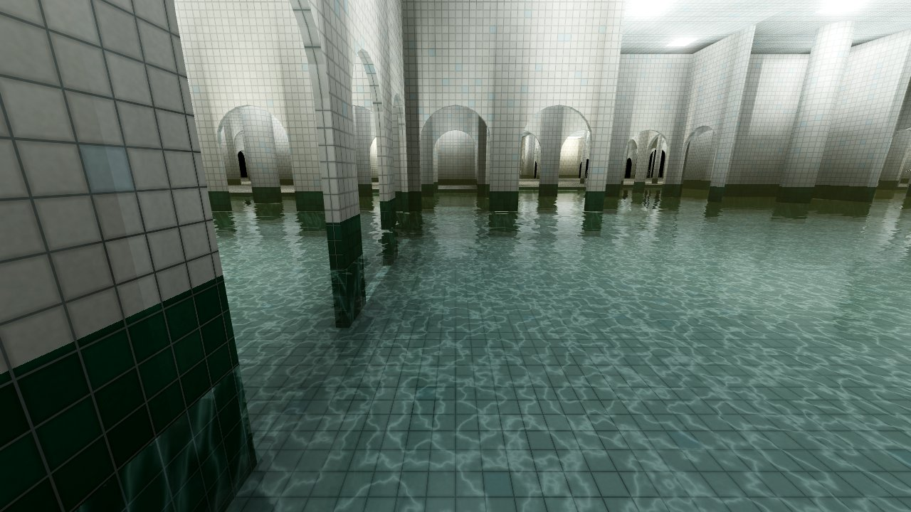
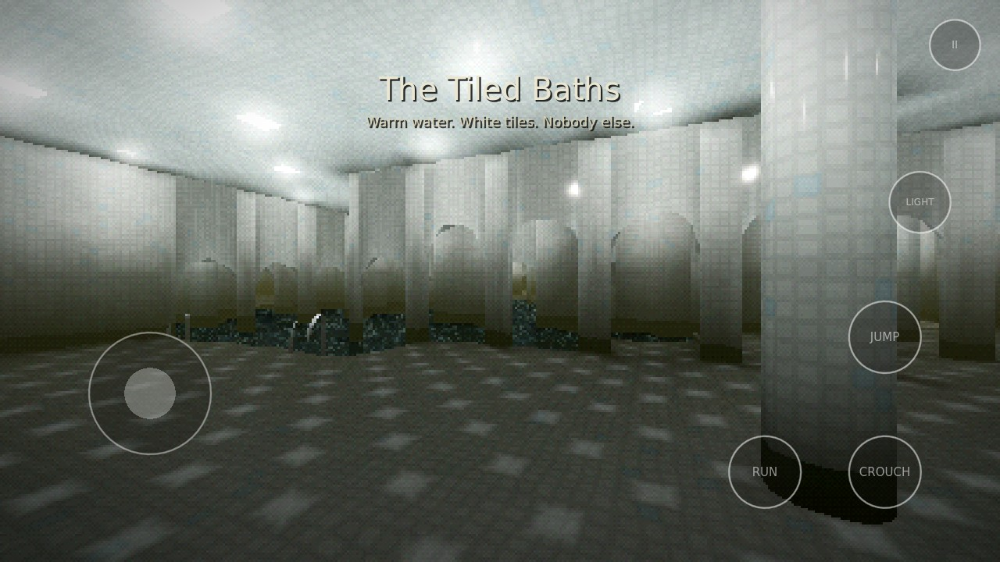
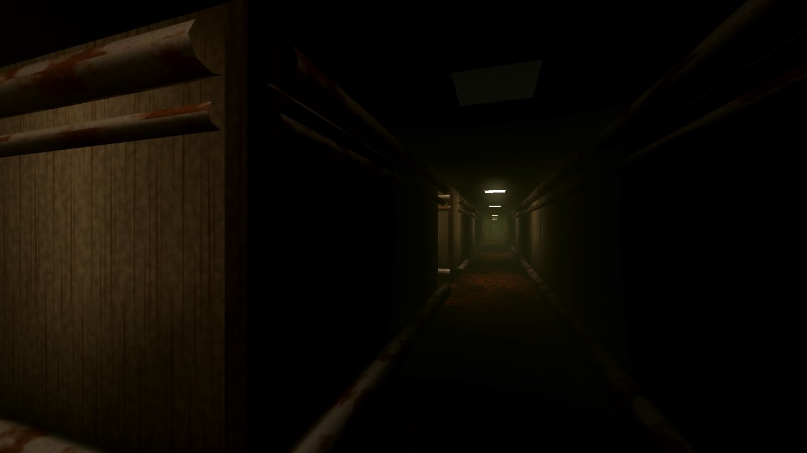
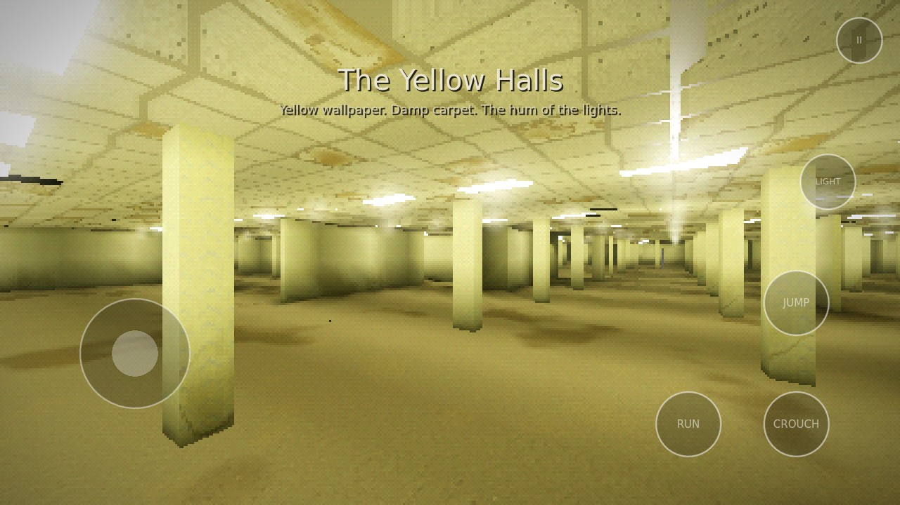
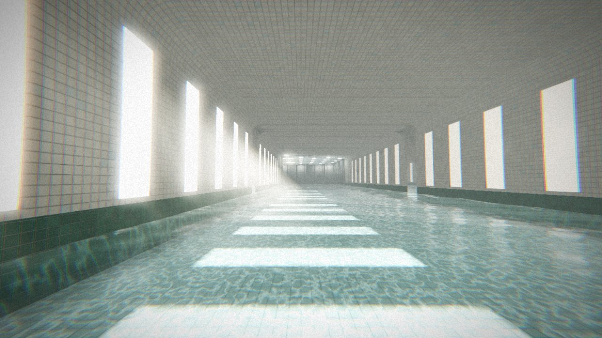
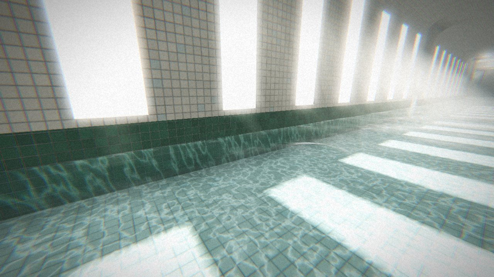

# Backrooms-OSS

An open source, infinite **Backrooms** exploration game for **Android** (and Linux/Windows), built with [Godot 4.7](https://godotengine.org).

You stepped through a wall that wasn't there. The hum of fluorescent lights, old damp carpet, and rooms that never end. Walk from the **Lobby** into the echoing **Poolrooms** (where, somewhere off through the tiles, you can always hear people you never find), the damp warehouse of the **Habitable Zone**, the cramped **Pipe Dreams** tunnels and the pitch-black **Unlit Halls**, all part of one seamless, endless world with no loading screens.

| Level 0 - The Lobby | Level 37 - The Poolrooms |
|---|---|
|  |  |
| **Poolrooms arches (with touch controls)** | **Level 2 - Pipe Dreams** |
|  |  |
| **Open pillared halls** | **Level 1 - Habitable Zone** |
|  |  |
| **Poolrooms sun gallery** | **Sun patches and god rays** |
|  |  |

*(Screenshots are from a software renderer; desktop builds add SSR, SSAO, SSIL and volumetric fog.)*

## Features

- **Infinite, seamless world.** Minecraft-style chunk streaming: chunks are generated nearest-first on background threads and uploaded under a strict per-frame time budget, so you can't see the world being built. Generation is deterministic from a seed, so any seed can be shared.
- **Graphics presets** (Potato / Low / Medium / High / Max, and **Photoreal** for high-end phones and PCs: real trim geometry (skirting boards, door casings, the ceiling's T-bar grid, light fittings with rims), lightmaps baked twice as sharp with soft corner occlusion, directional lightmaps so carpet pile, paper and concrete respond to the baked light, two-bounce radiosity baked into the lightmaps (every floor, wall and ceiling bounces light in its own colour, walls block it: colour bleeding and indirect shadows like a path-traced Cornell box, at no runtime cost), the flashlight bouncing off whatever it lights, parallax depth on tiles and pavers, optional photographed CC0 materials (`assets/textures/`), eye adaptation, an AgX film grade and a clean image; our own rendering, so it works on the Mobile renderer, no Forward+ needed), plus soft light halos and haze that imitate volumetric fog on the Mobile renderer.
- **Desktop builds use the Forward+ renderer**, which adds SSR, SSAO, SSIL bounce light, volumetric fog and SMAA. Android uses Godot's Mobile renderer, which the Godot docs recommend for phones (Forward+ there is "supported, but poorly optimized"). Desktop builds also offer **VoxelGI** under Settings → Graphics → Experimental (real-time bounce light from the flashlight and nearby fixtures). Phones get bounce light from Photoreal's baked radiosity instead.
- **Found footage camera** (a separate setting, any preset): the picture is reprocessed like a real cheap camera's, so it reads as recorded footage rather than a game. *Phone camera*: over-sharpening, grain that grows in the dark, colour blotching from compression, auto exposure that lags and hunts, white balance drift, handheld shake, REC and a running timer. *Camcorder (tape)*: soft picture, colour bleeding, faint interlace, lifted blacks, tracking glitches, and a date stamp.
- **Interactive water**: a GPU ripple simulation around you (wakes as you wade, rings and droplets when you jump in, drips from the ceiling), plus **real-time planar water reflections**, round tiled columns, arched colonnades, chrome pool ladders, skylights and a dark-green waterline band in the Poolrooms.
- **Sun galleries**: long flooded halls in the Poolrooms lined with tall frosted windows. Sunlight is traced through the windows into the lightmap (crisp window-shaped patches on the pool floor, with caustics), plus soft god rays and a coved ceiling.
- **Level 10 - The Field.** Somewhere on the walls of the Lobby there are rare sky-blue doors with daylight leaking under them. Walk through one and you're standing on an endless sunlit lawn under towering cumulus clouds, and the door behind you is gone. The only way back is another lone door standing somewhere out in the grass. Its clouds are raymarched once on the GPU into a panorama, so the sky costs one texture lookup per pixel.
- **The Dead Mall.** Some of those doors are different: bronze-framed frosted glass, warm light behind it and muffled mall music playing on the other side. It opens onto a shopping mall that closed years ago, about 240 m end to end and three floors high: galleries with glass balustrades on each side of an atrium that runs the whole length under a glass vault, shuttered stores on every level (some still lit inside), an arcade with its screens still on, a leaking roof, dead palms, a dry three-tier fountain at the bottom of a 15 m atrium under a pyramid skylight, a cafe row, a food court, a department store at the far end. The escalators in the Fountain Court are still running and carry you up; the glass lift still works (call it from any floor with Use, choose a floor inside, it chimes when it arrives), and "Fountain Court" still drifting from the ceiling speakers. Every prop and section is built in Blender from code (`tools/blender/mall_props.py`, `mall_kit.py`) with the lighting baked by Cycles into a lightmap per section, so it looks rich but costs a phone almost nothing to draw.
- **LAN multiplayer (1-4 players).** Host a new or saved game and friends on the same Wi-Fi join at any time: hosts are found automatically, or join by IP. Everyone is a hazmat-suited player (a skinned, procedurally built model with fabric creases, gloves, boots, a chest torch and a suit number you choose); movement, crouching, jumping and flashlights are synced and smoothed, footsteps are positional. Joining players appear right next to the host, and a hand-held radar (R / RADAR button) shows where everyone is, with their suit numbers: a bright blip for someone where you are, a faint one marked ▲1 / ▼2 for someone that many floors up or down (the floors share one plan, so the stairwells line up), and just their number with FIELD, MALL or their floor when they're somewhere else entirely. The Field and the Dead Mall behind a door are the same for everyone who takes that door, so you can go through together. You see others only where you are (same floor, same Field or Mall); seated players sit in their car. The world is generated identically from the seed on every device, so nothing but the seed and player states goes over the network. The entities are personal: each player sees their own.
- **Trails to the doors.** Earlier wanderers marked the way along the real route through the maze, up to about twenty-five rooms out: sky-blue painted arrows with a little sun lead to the Field, red marker arrows with a music note lead to the mall, at many of the junctions on the way. Closer in, dry leaves and grass blown in from the Field, or receipts, ticket stubs and a shopping bag from the mall, pile up thicker the nearer you get, and you can hear wind or muffled muzak through the door from about thirty metres.
- **Lobby details.** Scattered electrical outlets, light switches and vent grilles low on the walls, empty mounts where something once hung, indents in the carpet where furniture stood. Now and then a dark, sodden patch of carpet: the floor under it is rotten through, and if you step on it you fall through the dark and land somewhere far off in the Lobby. Rows of archways, plastic trash bins and buckets against the walls, like the photo that started it all. And rare thin places in the walls, where the wallpaper seam doesn't quite line up: lean into one and you noclip right through it, out of this part of the Lobby entirely.
- **Level 1 - Habitable Zone.** A damp, endless warehouse: painted concrete-block walls (a faded green dado, flaking, damp wicking up from the floor), puddles on the slab, rows of orange pallet racking stacked with cartons, crates left in the aisles, old warm fluorescents that flicker, and a dusty haze.
- **The Car Park.** The first floor down (B1) is mostly an underground car park: low concrete ceilings and beams, banded columns stencilled with bay numbers (not always in order), painted bays and lane arrows, oil stains, wheel stops, bare tube lights, and cars left under dust covers. Now and then one isn't: walk up to it and you can open its doors, get in the driver's seat, switch on the dome light and turn the key that's still in it (dashboard, headlights and tail lights come on; no driving). The wrecked ones further out have a flat battery. The cars sit in the baked light: soft occlusion on the floor under them, lit from the side the nearest tubes are on. Its stairwell doors open straight onto it. Further down there's a car park now and then.
- **A copy that gets worse.** The Lobby imitates an ordinary office building, and near where you start it's a convincing copy. Walk further out (or up or down a floor) and the imitation slips: exit signs that read EIXT or TIXE, door plaques like ROOM -1 or STAFF OLNY, doors with no doorway behind them and the handle on the hinge side, stairs that climb straight into the ceiling, a clock with thirteen hours and no hands, outlets with three slots, switches upside down or out of reach, stairwell landings with the wrong floor number. Far out, things have come loose: bins sunk into the carpet or half inside the walls, a bucket stuck upside down in the ceiling, doors half under the floor or sticking sideways out of a wall.
- **Floors above and below.** Now and then a grey steel door in the Lobby's wallpaper opens onto a concrete stairwell. Go down and the floors get older and darker (more pipes, more unlit halls); go up and they're emptier, more like offices. Every floor has its own layout, the floor numbers are stencilled on the landings (B1, B2... below), and there's no loading screen: the shaft is identical on every floor, so the next floor is swapped in while you're between landings.
- **Interconnected levels.** Large meandering regions turn the Lobby into the Poolrooms, the Habitable Zone, Pipe Dreams or the Unlit Halls. Borders always have doorways, so everything connects.
- **Only what you could see is drawn.** The world is a maze of rooms, so most of what's loaded is behind walls: a few times a second, rays are cast across the room grid from around you (on a worker thread) and only the chunks they reach are drawn, typically a third of those loaded. Our own, not the engine's occlusion culling, which 32-bit Android builds don't have.
- **Realistic lighting at mobile cost.** Each fixture's light is baked into per-pixel lightmaps as the chunk generates, on worker threads: direct light with wall occlusion through doorways, colored bounce light, and contact shadows. The nearest visible fixtures also get real-time lights that add moving specular highlights on tiles, puddles and water. On top of that come bloom, fog, filmic tonemapping, mirror-like water reflections of the ceiling lights, underwater caustics, glossy puddles and a hand-held flashlight with optional real-time shadows. Faulty tubes flicker, and their buzzing is synced to the flicker.
- **Almost no third-party assets.** Every texture (wallpaper, carpet, ceiling tiles, pool tiles, concrete, grass) is procedural in shaders, and every sound effect (fluorescent hum, room tone, water, wind, footsteps per surface, distant noises) is synthesized at startup. The music (*Empty Hours* and the mall's *Fountain Court*) is composed and rendered by `tools/music/compose.py` and `fountain_court.py` (also fully synthesized); the rendered OGGs are included so building needs no Python. All names, levels, creatures and text are this project's own. The exceptions are the car park's two cars, both CC0 (public domain): Poly Haven's "Covered Car" and 1DInc's "Generic SUV ZYX0" from BlendSwap (see `assets/garage/LICENSE.md`); the entities' bodies, a CC0 base mesh and CC0 walk and run clips from the Innerscene Free Parts Library, built from MakeHuman's CC0 assets (see `assets/entities/LICENSE.md`); the Poolrooms' far-off voices, two CC0 field recordings from Freesound (see `assets/audio/pool/LICENSE.md`); and the entities' screams, growls, breathing, hissing, footsteps and your heartbeat, CC0 recordings from Freesound (see `assets/audio/entities/LICENSE.md`).
- **Controls:**
  - Touch: a floating joystick, drag-anywhere look, and RUN / CROUCH / JUMP / LIGHT / pause buttons. **Every button can be moved and resized** in the layout editor, with adjustable opacity and sensitivity.
  - **Hardware keyboard and mouse** (including on Android): mouse capture, WASD, and fully **rebindable keys and mouse buttons**.
  - **Gamepads**: sticks for move/look, rebindable buttons, and full menu navigation.
  - On-screen controls hide automatically while you use a keyboard, mouse or gamepad, and come back when you touch the screen.
- **Movement:** walk, stamina-limited sprint, crouch, jump, wading through pools, and climbing out of them (just walk into the edge), with head bob and per-surface footsteps.
- **Settings:** render scale with FSR, MSAA, view distance, FPS cap, FOV, brightness, bloom, film grain/vignette, flashlight shadows, head bob, volumes and sensitivities.
- **Autosave & continue.**

Only one thing chases you. In the Lobby something else is walking, but you'll only ever hear it: heavy shoes on the damp carpet somewhere behind the walls (a heel and sole you can tell from your own steps, the hum dipping while it walks), coming your way, faster if you've been running, stopping to listen when you stand still, and never closer than the next room. Further in, something lives behind the wallpaper of the Unlit Halls: **The Lining**. You only ever see its shape pressing out through the paper, and it only moves when you aren't looking. It's drawn by the wallpaper shader itself (a baked height map bends the wall's normals, shading and pattern), so it costs almost nothing. And in the Unlit Halls, someone too tall stands under the last working lights at the far end of a hallway. It's only ever there when you turn around, and it's gone when your flashlight reaches it.

In the Unlit Halls there's something pale on all fours that you only see in your flashlight: while you aren't looking it creeps closer through the dark, in the beam it scuttles off, and if it reaches you it lunges with a shriek, leaving you winded and your torch knocked out. And something walks the car park's lanes: well over two metres tall, thin, long-armed and pitch black, a shape you see against the tube lights and lose in the dark, whose heavy footsteps and growls you hear long before you see it, and which prowls the lanes around wherever you are. If it sees you (a torch makes you easier to see, crouching harder) or hears you (running, a car door slamming, an engine starting) it comes for you, fast, and if it catches you, it's in your face (a jumpscare: it rushes you, eyes opening in the black, a scream, a white flash, then black; Settings > Jumpscares turns them off) and you're somewhere else. Lose it and it searches, then gives up. The cars are where you hide: sit in one with the doors shut and the lights off and it can't see you. It may come and look in through the window before it leaves, but if it saw you get in, it opens the door. All of them can be turned off in Settings.

The Dead Mall has no one in it.

## Download

Every push builds the Android APKs (`Backrooms-OSS.apk` for any phone, or the smaller `Backrooms-OSS-arm64.apk` for 64-bit phones and `Backrooms-OSS-armv7.apk` for 32-bit ones such as the Galaxy J7 Prime) plus Linux and Windows builds in GitHub Actions (**Actions → Build → Artifacts**). Pushing a tag like `v0.1.0` publishes them as a GitHub Release.

Debug-signed APKs install fine via sideloading. To get release-signed APKs, add the repository secrets `ANDROID_KEYSTORE_BASE64`, `ANDROID_KEYSTORE_ALIAS` and `ANDROID_KEYSTORE_PASSWORD`.

## Default controls

| Action | Keyboard / mouse | Gamepad |
|---|---|---|
| Move | WASD / arrow keys | Left stick |
| Look | Mouse | Right stick |
| Sprint | Shift | L3 |
| Crouch | Ctrl / C | B / Circle |
| Jump / climb | Space | A / Cross |
| Flashlight | F / right mouse | Y / Triangle |
| Use (car doors, switches) | E | LB / L1 |
| Pause | Esc / P | Start |

Everything except the sticks can be rebound in **Settings → Bindings**.

## Building from source

1. Install [Godot 4.7](https://godotengine.org/download) (standard build, not .NET).
2. Open `project.godot` and press **Play**.
3. To build for Android, install the Android export templates and an Android SDK (see [Godot's Android export docs](https://docs.godotengine.org/en/stable/tutorials/export/exporting_for_android.html)), then use **Project → Export → Android**. The non-Gradle export is used, so no Android Studio is needed.

The project uses the **Mobile** renderer and falls back to OpenGL ES 3 (Compatibility) on devices without good Vulkan support.

## How it works

| File | Role |
|---|---|
| `scripts/world/world_gen.gd` | Pure, seeded functions describing the infinite world: biomes (warped Voronoi regions), walls on cell edges, pillars, pools, light fixtures and their flicker. |
| `scripts/world/chunk_builder.gd` | Runs on worker threads. Builds one 8×8-cell chunk: meshes, baked per-vertex lighting (with grid ray-marching for wall occlusion), AO and collision. |
| `scripts/world/chunk_manager.gd` | Streams chunks around the player: nearest-first scheduling, time-budgeted uploads, unloading. |
| `shaders/` | Procedural materials. `common.gdshaderinc` holds baked-light decoding, the flicker function and fake planar reflections of the light grid. |
| `scripts/audio/` | Sound synthesis and the ambience/footstep/reverb system. |
| `scripts/player/player.gd` | First-person controller. |
| `scripts/ui/` | Menus, settings, key rebinding, touch controls and layout editor, HUD. |
| `scripts/game.gd` | State machine: menu, loading, intro, play, pause, save. |
| `_test/` | Dev harnesses that render screenshots (`render_test.tscn`) and drive a scripted play-through (`play_test.tscn`). |

Because every query is a pure function of `(seed, x, z)`, neighbouring chunks always agree at their seams even though they're generated independently and in parallel.

## Roadmap ideas

More places of our own (an abandoned office floor, a stretch where every light is dead), ways between levels via stairs and elevators, items, and a sanity mechanic. Contributions are welcome, as long as they are original (no names, levels, creatures or text taken from wikis, stories, films or other games).

## License

[MIT](LICENSE). Made with the Godot Engine (MIT).
