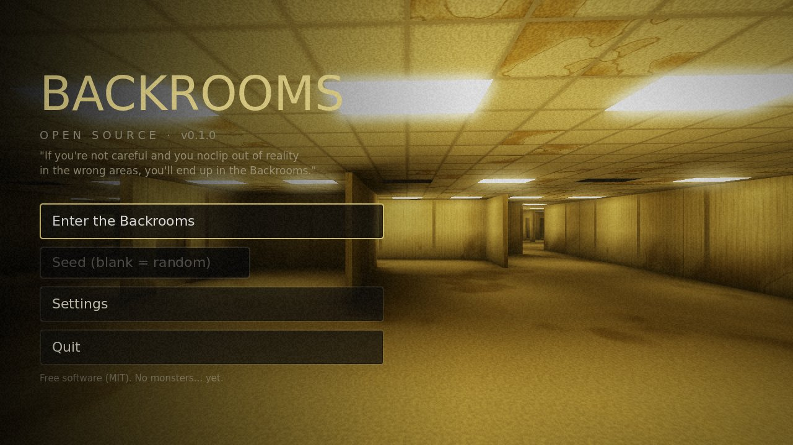
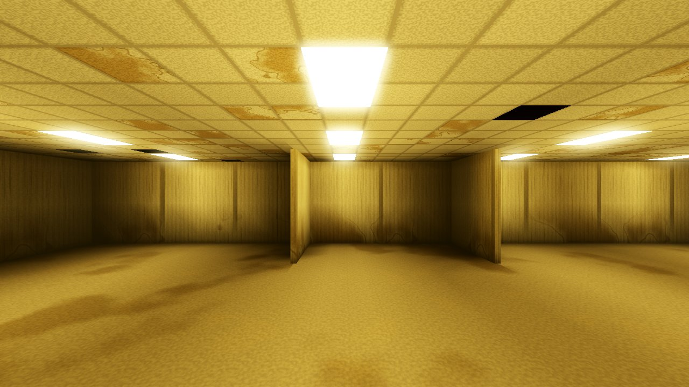
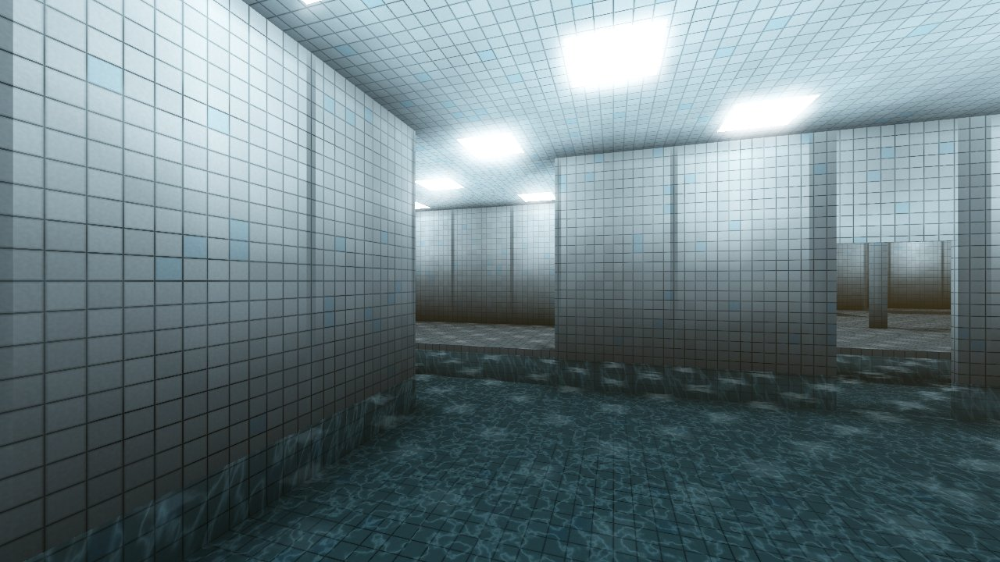
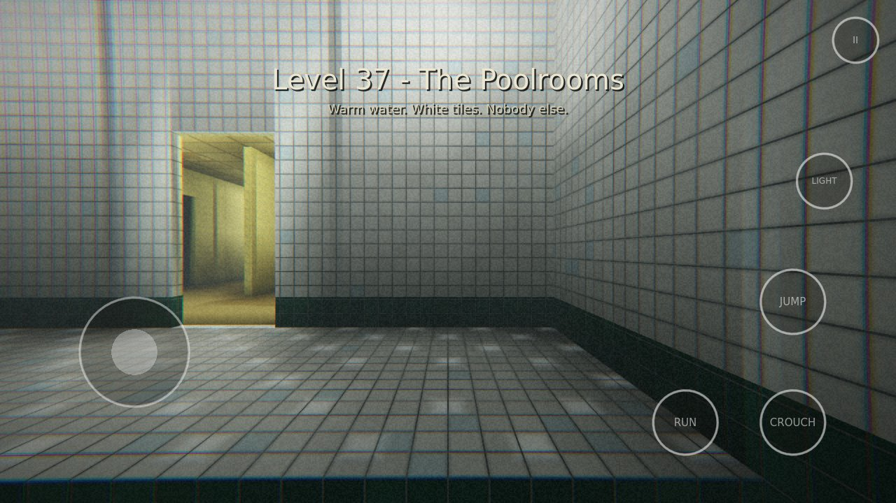
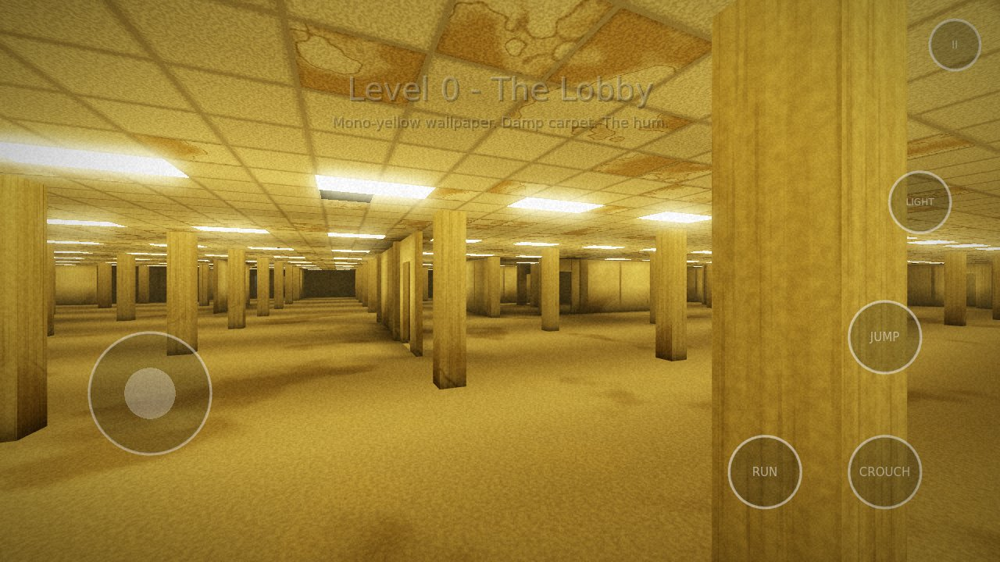
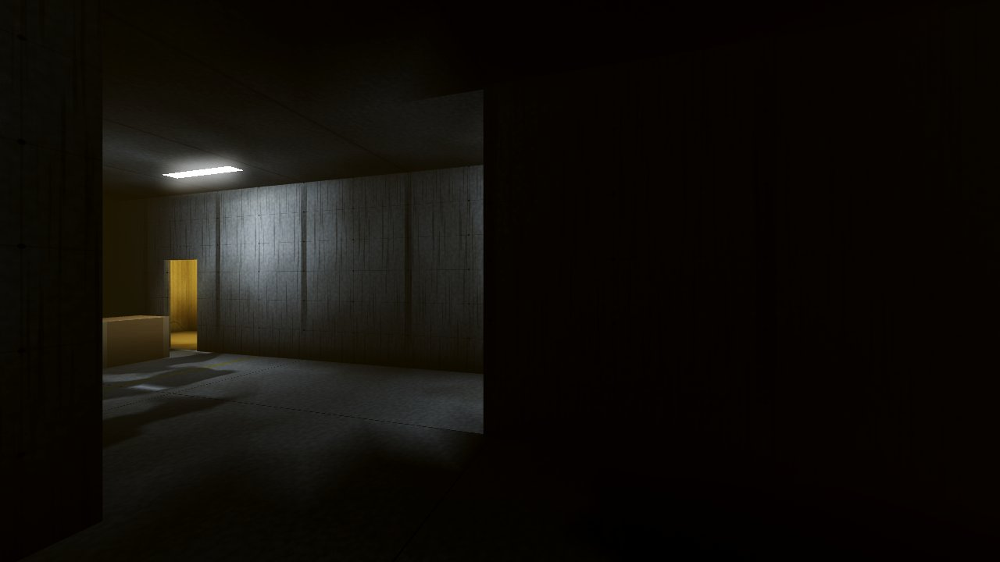

# Backrooms-OSS

An open source, infinite **Backrooms** exploration game for **Android** (and Linux/Windows), built with [Godot 4.7](https://godotengine.org).

You noclipped out of reality. The hum of fluorescent lights, old moist carpet, and rooms that never end. Walk from the mono-yellow **Lobby** into the echoing **Poolrooms**, the concrete **Habitable Zone**, the cramped **Pipe Dreams** tunnels and the pitch-black **Unlit Halls**, all part of one seamless, endless world with no loading screens.

| Level 0 - The Lobby | Level 37 - The Poolrooms |
|---|---|
|  |  |
| **Poolrooms arches (with touch controls)** | **Level 2 - Pipe Dreams** |
|  |  |
| **Open pillared halls** | **Level 1 - Habitable Zone** |
|  |  |

*(Screenshots are from a software renderer; desktop builds add SSR, SSAO, SSIL and volumetric fog.)*

## Features

- **Infinite, seamless world.** Minecraft-style chunk streaming: chunks are generated nearest-first on background threads and uploaded under a strict per-frame time budget, so you can't see the world being built. Generation is deterministic from a seed, so any seed can be shared.
- **Graphics presets** (Low / Medium / High / Max), plus soft light halos and haze that imitate volumetric fog on the Mobile renderer.
- **Desktop builds use the Forward+ renderer**, which adds SSR, SSAO, SSIL bounce light, volumetric fog and SMAA. Android uses Godot's Mobile renderer, which the Godot docs recommend for phones (Forward+ there is "supported, but poorly optimized"). See [`engine/README.md`](engine/README.md) for notes on a possible future Android Forward+ build.
- **Interactive water**: a GPU ripple simulation around you (wakes as you wade, rings and droplets when you jump in, drips from the ceiling), plus **real-time planar water reflections**, round tiled columns, arched colonnades, chrome pool ladders, skylights and a dark-green waterline band in the Poolrooms.
- **Interconnected levels.** Large meandering regions turn the Lobby into the Poolrooms, the Habitable Zone or the Unlit Halls. Borders always have doorways, so everything connects.
- **Realistic lighting at mobile cost.** Each fixture's light is baked into per-pixel lightmaps as the chunk generates, on worker threads: direct light with wall occlusion through doorways, colored bounce light, and contact shadows. The nearest visible fixtures also get real-time lights that add moving specular highlights on tiles, puddles and water. On top of that come bloom, fog, filmic tonemapping, mirror-like water reflections of the ceiling lights, underwater caustics, glossy puddles and a hand-held flashlight with optional real-time shadows. Faulty tubes flicker, and their buzzing is synced to the flicker.
- **Zero binary assets.** Every texture (wallpaper, carpet, ceiling tiles, pool tiles, concrete) is procedural in shaders, and every sound (fluorescent hum, room tone, water, footsteps per surface, distant noises) is synthesized at startup. The whole game is readable source code.
- **Controls:**
  - Touch: a floating joystick, drag-anywhere look, and RUN / CROUCH / JUMP / LIGHT / pause buttons. **Every button can be moved and resized** in the layout editor, with adjustable opacity and sensitivity.
  - **Hardware keyboard and mouse** (including on Android): mouse capture, WASD, and fully **rebindable keys and mouse buttons**.
  - **Gamepads**: sticks for move/look, rebindable buttons, and full menu navigation.
  - On-screen controls hide automatically while you use a keyboard, mouse or gamepad, and come back when you touch the screen.
- **Movement:** walk, stamina-limited sprint, crouch, jump, wading through pools, and climbing out of them (just walk into the edge), with head bob and per-surface footsteps.
- **Settings:** render scale with FSR, MSAA, view distance, FPS cap, FOV, brightness, bloom, film grain/vignette, flashlight shadows, head bob, volumes and sensitivities.
- **Autosave & continue.**

No monsters in v0.1. The emptiness is the horror for now.

## Download

Every push builds the Android APK (`Backrooms-OSS.apk`) plus Linux and Windows builds in GitHub Actions (**Actions → Build → Artifacts**). Pushing a tag like `v0.1.0` publishes them as a GitHub Release.

Debug-signed APKs install fine via sideloading. To get release-signed APKs, add the repository secrets `ANDROID_KEYSTORE_BASE64`, `ANDROID_KEYSTORE_ALIAS` and `ANDROID_KEYSTORE_PASSWORD`.

## Default controls

| Action | Keyboard / mouse | Gamepad |
|---|---|---|
| Move | WASD / arrow keys | Left stick |
| Look | Mouse | Right stick |
| Sprint | Shift | L3 |
| Crouch | Ctrl / C | B / Circle |
| Jump / climb | Space | A / Cross |
| Flashlight | F / right mouse | Y / Triangle |
| Pause | Esc / P | Start |

Everything except the sticks can be rebound in **Settings → Bindings**.

## Building from source

1. Install [Godot 4.7](https://godotengine.org/download) (standard build, not .NET).
2. Open `project.godot` and press **Play**.
3. To build for Android, install the Android export templates and an Android SDK (see [Godot's Android export docs](https://docs.godotengine.org/en/stable/tutorials/export/exporting_for_android.html)), then use **Project → Export → Android**. The non-Gradle export is used, so no Android Studio is needed.

The project uses the **Mobile** renderer and falls back to OpenGL ES 3 (Compatibility) on devices without good Vulkan support.

## How it works

| File | Role |
|---|---|
| `scripts/world/world_gen.gd` | Pure, seeded functions describing the infinite world: biomes (warped Voronoi regions), walls on cell edges, pillars, pools, light fixtures and their flicker. |
| `scripts/world/chunk_builder.gd` | Runs on worker threads. Builds one 8×8-cell chunk: meshes, baked per-vertex lighting (with grid ray-marching for wall occlusion), AO and collision. |
| `scripts/world/chunk_manager.gd` | Streams chunks around the player: nearest-first scheduling, time-budgeted uploads, unloading. |
| `shaders/` | Procedural materials. `common.gdshaderinc` holds baked-light decoding, the flicker function and fake planar reflections of the light grid. |
| `scripts/audio/` | Sound synthesis and the ambience/footstep/reverb system. |
| `scripts/player/player.gd` | First-person controller. |
| `scripts/ui/` | Menus, settings, key rebinding, touch controls and layout editor, HUD. |
| `scripts/game.gd` | State machine: menu, loading, intro, play, pause, save. |
| `_test/` | Dev harnesses that render screenshots (`render_test.tscn`) and drive a scripted play-through (`play_test.tscn`). |

Because every query is a pure function of `(seed, x, z)`, neighbouring chunks always agree at their seams even though they're generated independently and in parallel.

## Roadmap ideas

More levels (Level 4 office, Level 6 "Lights Out"), exits between levels via stairs and elevators, almond water and items, a sanity mechanic, and entities. Contributions are welcome!

## License

[MIT](LICENSE). Made with the Godot Engine (MIT).
